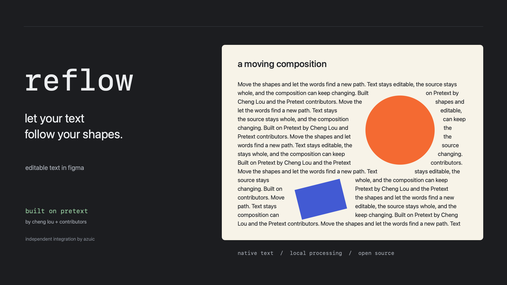

# reflow · built on Pretext

An independent, open-source Figma Design plugin that reflows native editable text around moving and resized shapes while its panel remains open. It wraps **the actual `@chenglou/pretext` 1.0.0 library by Cheng Lou**, bundled locally and unmodified. No API keys, paid services or network access are required.



Built on [Pretext](https://github.com/chenglou/pretext) by **Cheng Lou and the Pretext contributors**. Inspired by the [moving-shapes editorial demo](https://chenglou.me/pretext/editorial-engine/). This Figma integration is maintained separately by [azuic](https://github.com/azuic); it is not an official Pretext or Figma product. See [credits and licenses](CREDITS.md).

## Install the built plugin

1. In **Figma desktop**, open a Design file.
2. Choose **Plugins → Development → Import plugin from manifest…**.
3. Select the `manifest.json` in the downloaded or cloned repository.
4. Run **Plugins → Development → reflow · built on pretext**.

The built `dist/code.js` and `dist/ui.html` are included. You do **not** need Node or npm to use the built plugin. Keep the manifest and `dist` folder together. This is the development installation route. Community submission is tracked in [publishing](publishing/README.md). The manifest includes the Figma-assigned plugin ID. An ID alone does not mean the plugin has passed Community review.

## Use the panel

The default panel contains two selection pills, a draggable padding value field, and one start/stop button. Drag the field’s spacing icon horizontally to scrub the value (hold Shift for fine control), click the number to type, or use arrow keys on the icon. Borders are half-pixel hairlines. UI copy is lowercase; selected layer names and source text retain their original case. The footer reads “built on pretext.” Empty pills are inactive; selecting a text layer or shape fills its pill with the layer name. Multiple shapes show the first name plus a count; hover for all names. Start is enabled when both requirements are met, and binds the selection automatically. A running or paused binding stays attached while you select and move its obstacle.

To replace either input, click its pill: **T** for text, the **pentagon** for shapes. Then select the replacement on the canvas or in Figma's Layers panel. The other input stays linked. Multiple selected shapes are accepted together. Click the same pill again to cancel, or press **start reflow** after choosing the replacement to apply it. Picking pauses live reflow and leaves the previous generated output intact. To use a transparent source layer, select it in the Layers panel. Source editing controls are disabled while replacements are staged to prevent editing the previous source by mistake.

**More** holds source editing, source reveal, demo, output removal and diagnostics. Opening or closing more or diagnostics fits the panel height to its content, including after manual resizing, while preserving your chosen width. Drag the lower-right corner to resize the window in both directions. The corner also supports arrow keys (Shift uses larger steps). The panel uses dark charcoal surfaces, hairline borders, Departure Mono headings and cyan/yellow/green accents. Departure Mono is bundled locally under its SIL Open Font License (`assets/DEPARTURE-MONO-LICENSE.txt` and the copy in `dist`).

## Try it

Open **More → Create demo**, then press **Start reflow**. Move the orange ellipse, resize or rotate the blue rectangle. **more → diagnostics** shows poll samples, changed input geometries, page events and rendered layouts. The safe demo is created away from existing page content.

For your own document:

1. Create a source **text box** with the width **and height** of the desired text region. A fixed-size text box is easiest; auto-width text must first be resized into a useful region.
2. Select **exactly one source text layer plus one or more obstacle shapes**. Check their names in the two pills. Do not select a frame containing the text as an obstacle.
3. Set **padding** (0–200 px), then press **Start reflow**.
4. Keep the panel open and move, resize or rotate the obstacles. Resize or move the source text box to change the region. The Text and Shape pills update as you select layers. Pressing Start captures the pair: subsequently selecting other shapes does not change the tracked obstacle list.
5. Edit the complete article in **More → Source text → Apply text**. Or use **More → Reveal source**, edit the native source, and start again. Applying text intentionally changes the source article; routine reflow never splits or replaces its content.
6. Click **Stop** to edit the generated native text fragments. A subsequent live reflow overwrites fragment edits, so edit the source for lasting changes.
7. **More → Remove output** restores the source’s original opacity and visibility and removes only tagged generated fragments. It preserves user shapes and any foreign content added to the output frame.

After closing the plugin, the editable output stays in the document. To resume, select its output frame (or any text fragment inside it), or select the linked source alone, reopen the plugin, and press **Start reflow**. Resume metadata lives on the output frame and its link on the source; no whole-document scan is needed. If you manually delete the output frame, select the source alone and press **Start reflow**: a small recovery record on the source restores the binding and original opacity for regeneration or cleanup.

## How the Pretext wrapper works

- A panel worker runs Pretext’s `prepareWithSegments` and `layoutNextLine`. The integration computes unoccupied horizontal intervals across each entire line-height band, then passes each interval’s width to Pretext. Pretext chooses the text breaks.
- Pretext’s documented custom `OffscreenCanvas` adapter reads a width cache. Missing strings are collected in batches and measured by a temporary **native Figma text node using the source font**. A worker has no DOM, so browser fallback fonts and browser emoji measurements cannot enter this path.
- Preparation caches measurements by source content and style. Geometry changes reuse them. Complete candidate fragments are also measured by Figma; if shaping makes a fragment exceed its slot, the wrapper asks Pretext again with a smaller budget. Provisional layouts never render.
- A 120 ms sandbox timer samples only the bound source and obstacles. Geometry/style signatures, revisions and one serialized write queue reject stale layouts. Changes to generated nodes do not participate in the input signature. Page `nodechange` events are counted for diagnostics, not relied on to drive reflow.
- One generated page-level frame follows the source’s absolute transform. It contains one native text node **per occupied line interval**; an obstacle can split a row into two or more fragments. Output nodes are reused when possible.
- The source is made **transparent (opacity 0)** after a successful layout, instead of being removed or made invisible. This retains its position in auto layout. Its full characters, font, region dimensions, parent and sibling order are retained. Cleanup/reveal restores its stored opacity.

Figma does not expose an exclusion-shape text-flow property for a single text node. Per-fragment text nodes are the tradeoff for editable native output; there is no continuous native text cursor across the entire output article. Every new reflow uses the complete source.

## Supported first-version scope

- One uniform font, font size, fill, decoration, text case and line height per source.
- Left aligned, original-case text with **zero letter spacing, paragraph spacing, paragraph indent and list spacing**, without lists. Unsupported source styling and missing fonts produce errors rather than silent substitutions.
- Rectangles, including rotation, use their transformed box; ellipses use a conservative circumscribed contour. Other shapes, groups and vectors use conservative absolute bounds. Stroke allowance is added. Holes, rounded corners, concave paths, shadows and effects are not contour-wrapped.
- Coordinates are transformed into the source’s local space, including rotated regions and transformed ancestors. Text inside instances is rejected. Output is page-level and does not inherit parent clipping, parent opacity or parent blend effects; use an ordinary unclipped frame for predictable results.
- Up to 12,000 source characters, 40 obstacles, 400 rows and 800 fragments. Overflow is reported in the panel; the full source is retained. Enlarge the source box or split the article to show more text.
- Pretext handles Unicode segmentation and line breaks, but Figma still renders each fragment independently. Mixed bidirectional paragraphs can reorder punctuation across fragment boundaries; this version is intended for left-to-right editorial flow. Browser/Figma metric identity is never assumed.

## Live dragging caveat

Figma documents asynchronous, batched change callbacks, not a guaranteed per-pointer-frame stream. Polling avoids relying on those callbacks but cannot make Figma expose positions it withholds during a native interaction. The target sampling interval is 120 ms, **not a 60 fps guarantee**. If Figma exposes intermediate positions, the plugin uses them; otherwise it reflows when the interaction commits. Large articles and first font measurement can be slower. Closing or stopping the plugin ends live reflow.

**Native Figma startup, editable output, font measurements, the local blob worker, movement by keyboard, and resizing through Figma properties are verified on this Mac.** Version 0.1.1 fixes a startup message-filter bug that left the panel at Loading. Intermediate updates while holding a pointer drag are still unverified. See `TESTING.md` for exact scope and remaining checks.

## Develop and verify

```sh
npm ci
npm run verify
```

Build dependencies are pinned in `package-lock.json`: TypeScript 7.0.2, esbuild 0.28.2 and official Figma plugin typings 1.142.0. Runtime dependency: Pretext 1.0.0. `dist` contains everything the manifest loads. After editing, rebuild and rerun/reload the development plugin in Figma.

```sh
npm run test:browser
# Open http://127.0.0.1:4187 in Chrome.
```

The browser fixture runs the actual built panel and bundled Pretext worker against **mock Figma measurements**, under a sandboxed iframe and a no-network Content Security Policy. It is a browser integration test, not a native Figma test.

## Sources and attribution

- [Pretext source and custom measurement adapter](https://github.com/chenglou/pretext), MIT, copyright 2026 Pretext contributors.
- [Pretext moving-shapes/editorial reference](https://chenglou.me/pretext/editorial-engine/).
- [Figma change-event batching and dynamic-page requirements](https://developers.figma.com/docs/plugins/api/properties/figma-on/).
- [Figma manifest](https://developers.figma.com/docs/plugins/manifest/).
- [Figma’s forum confirmation that local blob/data workers work with networkAccess none](https://forum.figma.com/ask-the-community-7/local-worker-script-considered-external-network-resource-to-networkaccess-manifest-option-14697).

`PRETEXT-LICENSE.txt` and `dist/PRETEXT-LICENSE.txt` retain the **complete** Pretext license, including Chromium, WebKit and Unicode/ICU notices. Keep that file with redistributed builds. Integration code is MIT licensed (see `LICENSE`).

## Support and privacy

Report bugs through [GitHub Issues](https://github.com/azuic/figma-reflow/issues), including the plugin version and steps to reproduce. Please omit private document content. The plugin has no network access, analytics, accounts or external processing. Source text and binding metadata stay in the Figma file. See [PRIVACY.md](PRIVACY.md).
